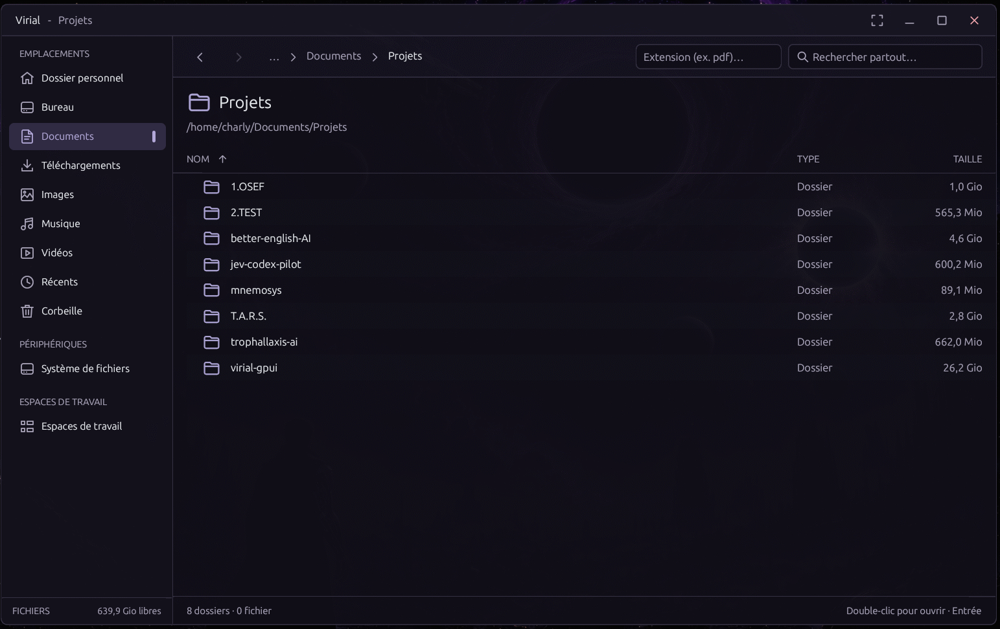

# Virial

Virial is a file manager for local and remote files on Linux, macOS and Windows. Browse folders, mounted drives, recent files, ZIP archives, and SSH/SFTP hosts in one place. Persistent workspaces, fast search, rich previews, and recoverable file operations make everyday file management easier and safer.

## Features

- **Tabs and views:** Open tabs with `Ctrl+T`, close them with `Ctrl+W`, and switch with `Ctrl+Tab` or `Ctrl+Shift+Tab`. Choose List or Grid with `Ctrl+1/2`. Toggle two independent panes with `Ctrl+4`, resize their divider, and focus the other pane with `Ctrl+6`. Copy and cut files between panes or tabs. Open Workspaces with `Ctrl+Shift+W`. On macOS, tab and view shortcuts also accept Command.
- **Browse anywhere:** Navigate local folders, recent files, persistent workspaces, mounted drives, ZIP archives, and remote servers over SSH/SFTP. Save host favorites and connect with your SSH agent, a private key, or a password; credentials are not saved.
- **Manage files safely:** Copy, move, rename, trash, and restore items with drag and drop, progress controls, and conflict handling. Destinations are never overwritten. Undo spans file and workspace changes, while local transfers and Trash jobs can recover after interruption.
- **Find files quickly:** Search by name or path across accessible locations, or filter a folder by file extension. A local index provides progressive results and keeps itself up to date.
- **Color tags:** Right-click local files or folders and choose **Tags** to toggle any of eight colors, including on a selection. Click a color below Workspaces in the sidebar to find its items. Tags are saved between sessions and follow moves and renames made in Virial.
- **Preview and organize:** Preview images, PDFs, audio, video, and text or code files. Edit ZIP archives, convert common image formats, remove image backgrounds, and group folders into workspaces.
- **Use Linux devices:** Browse and manage removable drives, including mount, unmount, and safe eject through UDisks2. The interface follows the system language when available and otherwise uses English.

## Install

Download the latest release from the [Releases page](https://github.com/Charlyhno-eng/virial-gpui/releases/latest) — no build, no toolchain required.

| Your system | Download | Then |
| --- | --- | --- |
| 🐧 Linux | [virial-gpui_0.1.2_amd64.deb](https://github.com/Charlyhno-eng/virial-gpui/releases/download/v0.1.2/virial-gpui_0.1.2_amd64.deb) | `sudo apt install ./virial-gpui_0.1.2_amd64.deb` — installs the launcher and the icon |
| 🍎 macOS | [Virial-0.1.2-macos-arm64.app.tar.gz](https://github.com/Charlyhno-eng/virial-gpui/releases/download/v0.1.2/Virial-0.1.2-macos-arm64.app.tar.gz) | Open the archive and drag `Virial.app` into Applications |
| 🪟 Windows | [virial-gpui-0.1.2-windows-x86_64.zip](https://github.com/Charlyhno-eng/virial-gpui/releases/download/v0.1.2/virial-gpui-0.1.2-windows-x86_64.zip) | Unzip anywhere and double-click `virial-gpui.exe` |

Every release also ships a `SHA256SUMS` file, so you can verify your download:

```sh
sha256sum --check SHA256SUMS
```

First launch on macOS: Gatekeeper shows a warning once — right-click the app,
choose *Open*, and macOS remembers it. On Windows, `virial-gpui.exe
--install-desktop` adds the taskbar identity and the `.env` / `.gitignore` /
`.toml` file associations (`--uninstall-desktop` removes them).

## See Virial in action



## Quickstart

### Prerequisites

On Debian or Ubuntu, install GPUI's native libraries and build tools:

```sh
sudo apt update && sudo apt install -y build-essential pkg-config libfontconfig1-dev libwayland-dev libx11-xcb-dev libxkbcommon-dev libxkbcommon-x11-dev libasound2-dev libvulkan-dev udisks2 poppler-utils libmpv2
```

Install Rust stable (1.85+) and Cargo if needed:

```sh
curl --proto '=https' --tlsv1.2 -sSf https://sh.rustup.rs | sh
```

### Run or install

From the project directory, run directly with `cargo run --release`, or build and install the executable, launcher, and icon under your home directory with:

```sh
./install.sh
```

Standalone binaries register their launcher and icon on first launch under `$XDG_DATA_HOME` (default `~/.local/share`). Register a downloaded executable with `./virial-gpui --install-desktop`.

Build a `.deb` (Debian/Ubuntu; requires `python3`, `dpkg-dev`, `binutils`): `./build-deb.sh`. Output: `target/debian`. Merging a version bump into `main` publishes the release to [GitHub Releases](https://github.com/Charlyhno-eng/virial-gpui/releases) automatically — see `RELEASE.md`.

### Tests

GitHub Actions runs the test suite on Linux, Windows and macOS, plus packaging and filesystem benchmarks on Ubuntu. Run the tests locally with `cargo test --locked`.
